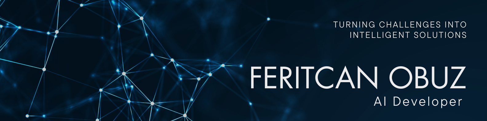
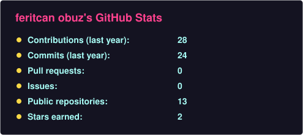
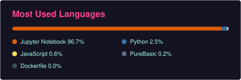
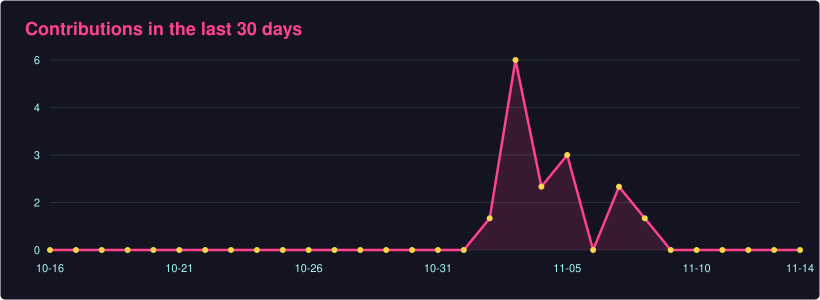

  

# Hi, I'm Feritcan Obuz

🔹 Statistics graduate, Eskişehir Osmangazi University (2026)  
🔹 I build AI systems end to end: data cleaning and modelling, LLM and computer vision models, and the backend, database and automation around them  
🔹 Recent work: an n8n + LLM order processing automation, a document verification product on Azure, and **12th place out of 493 teams** in Grid Up Datathon 2026  
🔹 Python • SQL • PyTorch • OpenAI API • n8n • FastAPI • PostgreSQL • Docker • Azure  

---

## Skills & Tools

* **Data & Statistics:** Python, Pandas, NumPy, Scikit-learn, SQL, Power BI, time series forecasting
* **LLM & Automation:** OpenAI API, Google Gemini API, prompt design and evaluation, n8n, webhooks, REST APIs
* **Deep Learning & Computer Vision:** PyTorch, TensorFlow, Keras, YOLO, OpenCV, CLIP, Sentence-Transformers
* **Edge AI & Optimization:** ONNX, TensorRT, post-training quantization, pruning
* **Backend & Cloud:** FastAPI, .NET 8, PostgreSQL, Docker, Azure, GitHub Actions, Git

---

## Featured Projects

🔹 **AI Trade Operations Automation**  
n8n automation that reads wholesale order emails from Gmail, extracts order lines with an LLM and checks every line against customer, product, stock and price data in PostgreSQL. Valid orders are saved with a reply draft, problem orders go to a human with the reason. Built on 1M rows of real wholesale invoice data and evaluated on a labelled set of 38 emails / 123 lines (100% routing and line extraction).  
*Tech:* n8n, OpenAI API, PostgreSQL, Docker, Python  
**Repo:** [ai-trade-operations-automation](https://github.com/feritcanobuz/ai-trade-operations-automation)

🔹 **Grid Up Datathon 2026: 12th of 493 teams (solo)**  
Daily electricity consumption forecasting for every transformer in a distribution grid (GDZ Elektrik & ADM Elektrik), metric RMSLE. The forecast is a sum of components: a Ridge-based daily index from weather and calendar, transformer-level profiles, a separate LightGBM/CatBoost model for transformers never seen in training, and correction terms fitted with time-based cross-validation.  
*Tech:* Python, Pandas, Scikit-learn, LightGBM, CatBoost  
**Repo:** [gridup-datathon-2026](https://github.com/feritcanobuz/gridup-datathon-2026)

🔹 **Proofly: Document Verification Platform (Nov 2025 - Sep 2026)**  
Independent product, built full time. An Excel add-in that verifies spreadsheet data against source documents. .NET 8 backend, Python/FastAPI OCR service, Azure (Container Apps, Document Intelligence, Entra ID, Key Vault), PostgreSQL with row-level security, CI/CD with GitHub Actions and 500+ automated tests.  
*Source is private.*

🔹 **Thesis: Object Detection on Thermal Images for Edge Devices**  
YOLO-based detection on FLIR thermal imagery, optimized for edge deployment with ONNX, TensorRT and post-training quantization.  
*Tech:* YOLO, PyTorch, ONNX, TensorRT

🔹 **SocialScanAI: Hybrid AI for Product Search and Tracking (Hackathon)**  
Text and image product search over four vector spaces (CLIP, Sentence-Transformers) merged with Reciprocal Rank Fusion, Gemini-based review sentiment for ranking offers across stores, and WhatsApp alerts for price drops and restocks.  
*Tech:* Python, FastAPI, CLIP, Sentence-Transformers, Google Gemini API, Twilio, Docker  
**Repo:** [SocialScanAI](https://github.com/feritcanobuz/SocialScanAI)

### Other projects

* [CNN-based jar lid quality control](https://github.com/feritcanobuz/-kavanoz-kapagi-kalite-kontrol-sistemi): defective / non-defective classification (~83% accuracy), FastAPI + Streamlit, Docker
* [License plate recognition](https://github.com/feritcanobuz/Plate-Recognition-System): real-time vehicle and plate detection with YOLOv8 and OpenCV
* [Chest X-ray pneumonia classification](https://github.com/feritcanobuz/image-data-presentation): CNN, statistical analysis course project
* [Earthquake magnitude and distance models for Türkiye](https://github.com/feritcanobuz/PGA-DL-ML-DEPREM): ML and DL models
* Remaining useful life prediction for aircraft engines (NASA C-MAPSS)
* Data analysis for two mining engineering PhD theses: gas sensor anomaly detection and risk clustering

---

## GitHub Stats

---

## Connect with Me

* **LinkedIn:** [https://www.linkedin.com/in/feritcan-obuz/](https://www.linkedin.com/in/feritcan-obuz/)
* **GitHub:** [https://github.com/feritcanobuz](https://github.com/feritcanobuz)
* **Email:** [feritcan.arena@gmail.com](mailto:feritcan.arena@gmail.com)

---

### Hakkımda (TR)

Eskişehir Osmangazi Üniversitesi İstatistik bölümünden 2026'da mezun oldum. Yapay zeka sistemlerini uçtan uca kuruyorum: verinin temizlenmesi ve modellenmesi, LLM ve bilgisayarlı görü modelleri, bunların etrafındaki backend, veritabanı ve otomasyon.

Son bir yılda Proofly adlı belge doğrulama ürününü Azure üzerinde tek başıma geliştirdim, Grid Up Datathon 2026'da 493 takım arasında 12. oldum ve n8n ile LLM kullanan bir sipariş işleme otomasyonu kurdum. Bitirme tezimde termal görüntülerde uç cihazlar için optimize edilmiş nesne tespiti üzerine çalıştım. İki maden mühendisliği doktora tezinin veri analizini yaptım.

**NeuraSTAT** ekibinin kurucusu olarak Kaggle ve hackathon/datathon yarışmalarına katılıyorum.

---

"Success is stumbling from failure to failure with no loss of enthusiasm." - Winston Churchill
